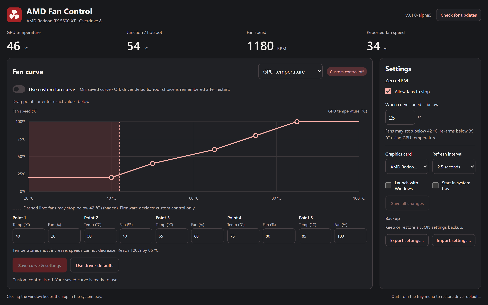
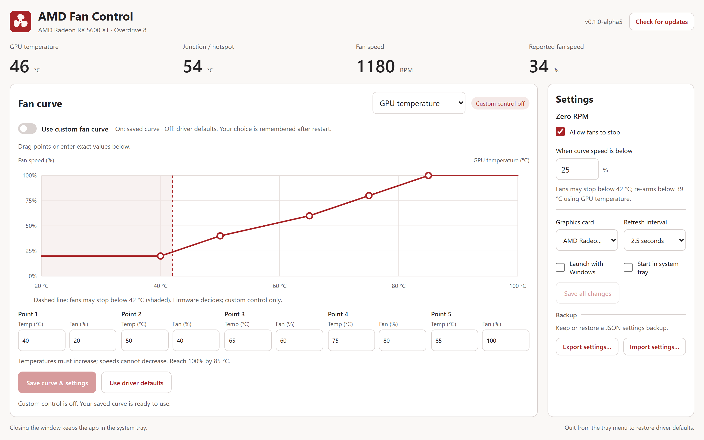
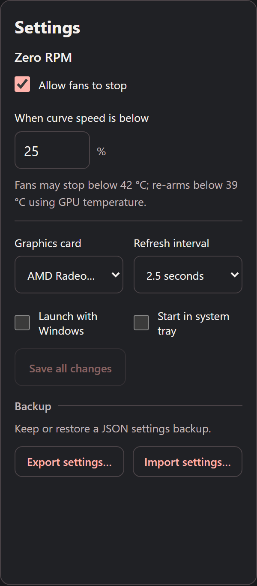

<p align="center"></p>

<p align="center">A lightweight desktop utility for AMD GPU fan curves on Windows and Linux, built with Rust and Tauri.</p>

<p align="center"><a href="https://github.com/itsmrma/amd-fan-control/releases">Downloads</a> · <a href="docs/ARCHITECTURE.md">Architecture</a> · <a href="docs/TESTING.md">Hardware testing</a></p>

## Why I built this

I got tired of using heavier tuning suites just to set a fan curve, so I built a focused fan-control app around my own graphics card: an **AMD Radeon RX 5600 XT**. I wanted a lightweight way to set a fan curve, read temperatures and fan speeds, and get back to the driver's defaults.

This is a personal project built around that card. **It is not a universal AMD fan controller, and I cannot guarantee it will work on other cards.** Even another RX 5600 XT can behave differently with a different board BIOS or driver.

<p align="center">
  
  
</p>

## Compatibility

### Windows

Windows 10/11 x64 with an AMD display driver and Microsoft Edge WebView2 Runtime. The Windows backend uses **ADL Overdrive8 native five-point fan curves**.

### Linux

Linux x64 with the open-source **`amdgpu` kernel driver** exposing `sysfs`/`hwmon` fan controls (`/sys/class/drm/card*/device/hwmon/hwmon*`). The Linux backend uses **host-driven PWM control** (`pwm1` and `pwm1_enable`) with `StepDown` hysteresis smoothing rather than native kernel Overdrive curve tables.

Architecture names alone do not establish compatibility: the driver must expose curve or PWM controls and temperature sensors.

These desktop Radeon families are reasonable candidates for the same approach, **not a tested support list**:

| AMD architecture | Desktop GPU family | Windows (ADL OD8) status | Linux (`amdgpu` `hwmon`) status |
| --- | --- | --- | --- |
| RDNA / Navi 1x | RX 5000, including my RX 5600 XT | Development target. Read-only curve capabilities, limits, telemetry, and Zero RPM toggle observed locally. Hardware writes still need validation. | Implemented against `amdgpu` `sysfs`/`hwmon` and verified in automated temp-`sysfs` tests. Real-hardware validation pending. |
| RDNA 2 / Navi 2x | RX 6000 | May work if the driver exposes the required ADL controls. Untested. | May work if `amdgpu` exposes `pwm1`/`pwm1_enable`. Untested on hardware. |
| RDNA 3 / Navi 3x | RX 7000 | May work if the driver exposes the required ADL controls. Untested. | May work if `amdgpu` exposes `pwm1`/`pwm1_enable`. Untested on hardware. |
| RDNA 4 / Navi 4x | RX 9000 | Candidate only; newer hardware/driver interfaces may differ. Untested. | Candidate only; `amdgpu` `hwmon` behavior may differ. Untested on hardware. |

Family names follow [AMD's RDNA documentation](https://www.amd.com/en/technologies/rdna.html). Possible compatibility is an implementation-based expectation, not an AMD support claim. See the [official ADL SDK](https://github.com/GPUOpen-LibrariesAndSDKs/display-library) and Linux `amdgpu` `hwmon` documentation for the underlying interfaces.

Legacy `radeon` (pre-`amdgpu`) kernel drivers, older GCN cards (Polaris/Vega), integrated graphics without fan control, laptop-controlled fans, and Radeon Pro cards are outside the validated scope. Legacy Overdrive5/6/N fan-control backends are not implemented.

## Features

- Resizable SVG curve editor with dragging, keyboard adjustment, and separate temperature/fan-speed labels.
- GPU edge temperature, junction/hotspot, fan RPM, and driver-reported speed percentage (or PWM duty percentage on Linux).
- Choose **GPU temperature** (default), **Junction / hotspot**, or **Driver / firmware sensor** above the chart. The selection is saved with your curve. On host-PWM-only backends (Linux), **Driver / firmware sensor** is clearly marked unavailable and blocked.
- A custom-curve switch: on applies your saved curve; off restores driver fan defaults, with driver readback verification.
- Descriptive button labels and hover help, plus a labeled Zero RPM cutoff on the chart.
- Optional **Zero RPM below a configurable curve-speed threshold**, initially **25%**.
- Persistent Settings panel, beside the curve in wide windows and below it in smaller windows.
- **Backup** section at the bottom of Settings: export and import the curve and settings as a JSON file for backups or another machine.
- **Check for updates** in the header, with one-click signed updates on Windows (NSIS) and Linux (`.AppImage`). Package-managed Linux installs (`.deb` / `.rpm`) direct you to GitHub Releases instead of self-updating in place.
- Automatic fan-default restoration, tray icon, optional **Launch at login** autostart, and start in tray.
- System light/dark appearance, local JSON, and a small vanilla TypeScript frontend.
- Windows NSIS/ZIP builds and Linux `.deb`, `.rpm`, `.AppImage`, and `fan-cli` tarball builds through GitHub Actions.

Only fan-related settings are written. Clocks, voltages, and power limits are untouched.

## Getting started

### Windows installation

Download from [Releases](https://github.com/itsmrma/amd-fan-control/releases): the NSIS `-setup.exe` installer or the portable ZIP. The setup handles WebView2; portable builds require it already installed. ADL is loaded from the AMD driver's `atiadlxx.dll` in System32; no separate DLL download is needed.

### Linux installation

Download from [Releases](https://github.com/itsmrma/amd-fan-control/releases):

- **Debian / Ubuntu (`.deb`)**: `sudo apt install ./amd-fan-control_*.deb`
  Installs the desktop app, runtime dependencies (`libwebkit2gtk-4.1-0`, `libgtk-3-0`, `libayatana-appindicator3-1`), and the `udev` rule at `/lib/udev/rules.d/60-amd-fan-control.rules`, then reloads `udev` rules automatically.
- **Fedora / RHEL (`.rpm`)**: `sudo dnf install ./amd-fan-control-*.rpm`
  Installs the desktop app, runtime dependencies (`webkit2gtk4.1`, `gtk3`, `libayatana-appindicator-gtk3`), and the `udev` rule at `/usr/lib/udev/rules.d/60-amd-fan-control.rules`, then reloads `udev` rules automatically.
- **Portable `.AppImage`**: Make executable (`chmod +x *.AppImage`) and run it. Read-only temperature and RPM monitoring works immediately; fan control requires installing the `udev` rule below.
- **Diagnostic CLI (`amd-fan-control-linux-x64-cli.tar.gz`)**: Extract to get `fan-cli`, `60-amd-fan-control.rules`, `config.example.json`, and `TESTING.md`.

#### Linux `udev` permissions (`.AppImage` and `fan-cli` tarball)

Without write permissions on `hwmon` PWM nodes, the app opens cleanly in **read-only monitoring mode** (temperatures, RPM, and backup export still work). To allow fan-speed writes without running the GUI as root, install [`packaging/linux/60-amd-fan-control.rules`](packaging/linux/60-amd-fan-control.rules) (also bundled inside `amd-fan-control-linux-x64-cli.tar.gz`):

```bash
sudo cp 60-amd-fan-control.rules /etc/udev/rules.d/60-amd-fan-control.rules
sudo udevadm control --reload-rules
sudo udevadm trigger --subsystem-match=hwmon --action=change
```

This rule grants local active-session write access (`TAG+="uaccess"`, plus `video` group `0664`) **strictly** to `pwm1` and `pwm1_enable` on `amdgpu` `hwmon` devices (PCI vendor `0x1002`). Clocks, voltages, and power limits are not exposed. If your session does not use `systemd-logind` `uaccess` ACLs, ensure your user is in the `video` group and log out/in.

#### Linux tray expectations (GNOME)

On Linux, Tauri's system tray relies on AppIndicator (`libayatana-appindicator3-1`). Desktop environments like KDE Plasma and XFCE display the tray icon out of the box, whereas **GNOME Shell** does not show AppIndicator tray icons unless an extension such as *AppIndicator and KStatusNotifierItem Support* is installed and enabled.

### Using the app

1. Close or disable other fan controllers (e.g. MSI Afterburner or Radeon Software fan tuning on Windows; `fancontrol`, `lact`, or `corectrl` on Linux).
2. Open the app and check temperatures and RPM. Select your GPU in **Settings** if necessary.
3. Drag the five points or edit **Temp (°C)** and **Fan (%)**. Focus a chart point to use left/right for temperature and up/down for speed; Shift uses steps of five.
4. Click **Save curve & settings**, then turn on **Use custom fan curve**. Saving alone does not change the fans.
5. Turn the switch off, or click **Use driver defaults**, to restore the driver's automatic fan control and Zero RPM defaults. Your saved curve is kept.

Closing the window keeps the app in the tray. **Quit** from the tray menu attempts restoration before exiting; if it fails, the app stays open and shows the error.

The custom-control switch is remembered immediately. If it was on, the app attempts to resume your saved curve on the same GPU after fresh telemetry is available, including when **Launch at login** starts the app. The switch shows on only after the driver confirms the settings. Turning it off or using **Use driver defaults** cancels startup restoration. **Quit** restores driver defaults for the current session while keeping your choice for the next launch. New and older profiles without a saved choice start with custom control off.

Configuration lives at:
- **Windows**: `%APPDATA%\amd-fan-control\config.json`
- **Linux**: `$XDG_CONFIG_HOME/amd-fan-control/config.json` (typically `~/.config/amd-fan-control/config.json`)

**Launch at login** (which writes a standard XDG autostart `.desktop` entry under `~/.config/autostart/` on Linux) takes effect immediately; other settings require **Save all changes**, which saves the whole draft including the curve. Missing GPU/sensors, unsafe temperatures, missing write permissions, or driver rejection block startup restoration and show an error; the app does not repeatedly retry a rejected curve.

The **Backup** section at the bottom of Settings holds **Export settings…** and **Import settings…**. Export saves the current curve and settings as JSON; import loads a previous backup into the editor. Imported values are not applied automatically: review them, save, then turn on **Use custom fan curve**. The exported file leaves out the current on/off switch choice, so restoring a backup never starts fan control by itself. The same JSON format works for `config.example.json` and a copied `config.json`.



### Updates

Use **Check for updates** in the header to ask GitHub for a newer release. On Windows NSIS and Linux `.AppImage` installs, if one exists, the button becomes **Install**; the app downloads the package, verifies its Tauri minisign signature, installs it, and restarts. Package-managed Linux installs (`.deb` and `.rpm`) cannot self-update in place and show a notice directing you to GitHub Releases. Update checks are manual only. The updater accepts only packages produced and signed by the project's GitHub Actions release workflow; local builds cannot replace a release. Windows Authenticode signing still requires a separately purchased certificate, so alpha Windows installers remain unsigned by Windows itself.

### Curve temperature

**GPU temperature** uses the normal edge reading; **Junction / hotspot** uses that sensor explicitly. Profiles without a selection default to GPU temperature. A missing selected sensor blocks activation, including startup restoration, or stops active control with a restoration attempt. There is no silent substitution.

- **Windows (ADL Overdrive8)**: These two modes interpolate the saved curve once per second, updating OD8 only when requested speed or Zero RPM changes. The native curve holds that speed across the normal firmware temperature range, retaining a final ramp to 100% at the driver's maximum curve temperature (capped at 100 °C). **Driver / firmware sensor** sends the five saved points directly to the driver.
- **Linux (`amdgpu` `hwmon`)**: These two modes run a one-second host-PWM control loop with **`StepDown` hysteresis** (speed increases apply immediately; speed decreases require the selected temperature to stay at least 3 °C below the held temperature for 6 seconds), writing `pwm1_enable=1` and `pwm1` (`0..=255`) only when the target changes. **Driver / firmware sensor** is unavailable on host-PWM-only backends.

Edge ≥90 °C and hotspot ≥105 °C safeguards remain active for every selection.

### Zero RPM

Enable **Allow fans to stop** and set **When curve speed is below**. The initial threshold is **25%**. Set the first point below that value, for example **40 °C / 20%**, so the curve enters the fan-stop region. Existing profiles keep Zero RPM disabled until you enable and save it.

The threshold refers to **speed requested by the curve**, not measured fan percentage. The app interpolates a temperature cutoff, rounded down to whole degrees. It requests fan stop when the selected sensor is more than 3 °C below that cutoff, and withdraws the request at or above the cutoff. Firmware mode on Windows uses the hotter available reading. The cutoff cannot exceed 60 °C. The dashed line and shaded region show where fans may stop while custom control is on. The solid line shows your requested curve.

On Windows, the worker toggles native Zero RPM permission; on Linux, it writes `pwm1=0` in manual mode when `pwm1_min` is absent or `0`. **This requests fan stop; it does not guarantee physical fan stop.** Firmware/VBIOS may keep the fans running because of temperature, power, minimum-PWM clamping, or restart conditions. Confirm actual stopping through RPM (`fan1_input` on Linux); an enabled flag or `pwm1=0` is not proof of 0 RPM. Unsupported drivers (including Linux `pwm1_min > 0`) leave this option unavailable.

If the driver rejects a Zero RPM change (such as **ADL -8** on Windows or `pwm1_min > 0` / rejected `pwm1=0` on Linux), the app attempts to restore driver defaults and states whether that succeeded. Turn off **Allow fans to stop**, save, and try the custom curve again. Expand **Technical details** to see the driver error.

## Alpha limitations

- **Automated vs hardware validation**: Automated tests cover curve/policy math, `SysfsBackend` filesystem I/O against simulated `sysfs` trees, worker state-machine safety/recovery, mocked-IPC Playwright UI checks, updater manifest validation, and CI packaging. **Real-hardware writes, physical fan stop/restart, and desktop lifecycle behavior still need [hardware validation](docs/TESTING.md) on both Windows and Linux.** Automated checks do not certify physical fan behavior.
- Five points: increasing temperatures, non-decreasing speeds, and 100% by 85 °C. Running speeds must be 20–100% and within driver limits; stopping uses the separate Zero RPM policy.
- The worker attempts restoration at edge ≥90 °C or hotspot ≥105 °C, repeated telemetry failures, long polling stalls, and detected external changes. These are application safeguards, not official GPU limits.
- No independent watchdog or privileged daemon. Forced termination (`SIGKILL` / power loss) cannot clean up: manual curves or `pwm1_enable=1` may remain active while the software control loop stops updating. Immediate restoration after crashes, driver resets, or sleep is not guaranteed.
- Reported percentage is the driver's RPM/max-RPM ratio on Windows or `pwm1 / 255` duty percentage on Linux. Missing/stale sensors show an em dash (`—`).
- Firmware retains native emergency escalation and restart conditions.

## Development

### Windows prerequisites

Node.js 22 LTS or newer, Rust stable/MSVC ≥1.90, Visual Studio Build Tools with **Desktop development with C++**, Windows SDK, and WebView2 Runtime. Pinned AMD ADL headers are included.

### Linux prerequisites

Node.js 22 LTS or newer, Rust stable ≥1.90, and system development libraries (Ubuntu/Debian example matching CI):

```bash
sudo apt-get update
sudo apt-get install -y \
  libwebkit2gtk-4.1-dev build-essential curl wget file \
  libxdo-dev libssl-dev libayatana-appindicator3-dev \
  librsvg2-dev libglib2.0-dev pkg-config patchelf rpm
```

Clone and run in dev mode:

```bash
git clone https://github.com/itsmrma/amd-fan-control.git
cd amd-fan-control
npm ci
npm run tauri dev
```

Read-only diagnostics:

```bash
cargo run --locked -p fan-cli -- list
# Replace with the exact PCI ID returned by list (e.g. pci:41:0:0 on Windows, pci:03:00.0 on Linux).
cargo run --locked -p fan-cli -- probe 'pci:03:00.0'
```

`probe` reads capabilities, current state, and three samples without writing fan settings. The explicit `test-curve` command runs a 15-second hardware test and then requests defaults; read [the procedure](docs/TESTING.md) first.

Automated checks and packaging:

```bash
npm run build
node --test tests/updater-manifest.test.mjs
npx playwright install chromium
npm run test:ui
cargo fmt --all --check
cargo test --locked --workspace
cargo clippy --locked --workspace --all-targets -- -D warnings
# Linux-only GLib iterator regression test:
cargo test --locked --release -p glib-security-regression
# Bundle installers:
# Windows: npm run tauri build -- --bundles nsis
# Linux:   APPIMAGE_EXTRACT_AND_RUN=1 npm run tauri build -- --bundles deb,rpm,appimage
```

| Directory | Purpose |
| --- | --- |
| `crates/fan-core/` | Curve validation/interpolation, `StepDown`, Zero RPM policy, JSON, `GpuBackend` trait |
| `crates/amd-adl/` | Windows ADL wrapper + C++ bridge, and Linux `amdgpu` `sysfs`/`hwmon` backend |
| `crates/fan-cli/` | Diagnostics (`list`, `probe`), 15-second `test-curve`, `reset` |
| `src-tauri/src/` | Tauri commands, hardware worker, tray, autostart, bundle type detection |
| `src/` | TypeScript, CSS, responsive SVG chart |
| `packaging/linux/` | Linux `udev` rule (`60-amd-fan-control.rules`) and `.deb`/`.rpm` maintainer scripts |
| `assets/` | Original logo/icon and interface preview |

See [ARCHITECTURE.md](docs/ARCHITECTURE.md) for ownership, `StepDown`, `flock`, and recovery details.

## Builds and releases

[CI](.github/workflows/build.yml) runs core tests on Ubuntu, Windows tests/lint/NSIS/ZIP packaging, and Linux (`ubuntu-22.04`) tests/lint/`.deb`/`.rpm`/`.AppImage`/`fan-cli` tarball packaging. Normal builds produce Actions artifacts; a `v*` tag publishes a prerelease after checks pass, with `SHA256SUMS.txt` and GitHub build-provenance attestations.

`bundle.createUpdaterArtifacts` makes Tauri sign the Windows NSIS installer and Linux `.AppImage` with the update key. The release job copies the `.sig` files, writes `latest.json` for `windows-x86_64` and `linux-x86_64`, validates it with `scripts/validate-updater-manifest.mjs`, and refreshes the rolling `updater` release. The app checks `https://github.com/itsmrma/amd-fan-control/releases/download/updater/latest.json`, so prerelease tags can be discovered. The matching private key exists only in the `TAURI_SIGNING_PRIVATE_KEY` and `TAURI_SIGNING_PRIVATE_KEY_PASSWORD` Actions secrets. To rotate the key, generate a new pair with `npm run tauri signer generate`, replace the public key in `src-tauri/tauri.conf.json`, and update both secrets in the same release. Users on a build signed with the previous key must install that release manually.

Keep `Cargo.toml`, `package.json`, lockfiles, and `src-tauri/tauri.conf.json` versions aligned before tagging.

README screenshots are regenerated from the mocked browser preview with `node scripts/capture-screenshots.mjs` while `npm run dev -- --port 1421` is running.

MIT. Independent project, not affiliated with AMD or MSI. [Third-party notices](THIRD_PARTY_NOTICES.md).
