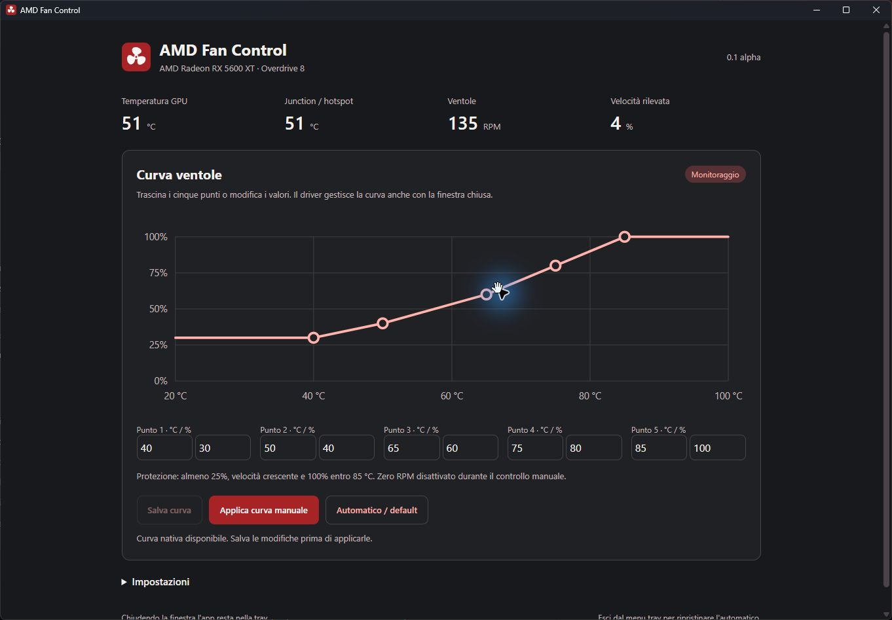

<p align="center"></p>

<p align="center">Una piccola utility desktop Rust + Tauri per la curva ventole AMD.<br />Windows 10/11 prima di tutto. Progettata intorno alla Radeon RX 5600 XT.</p>

<p align="center"><a href="https://github.com/itsmrma/amd-fan-control/releases">Scarica la release</a> · <a href="docs/ARCHITECTURE.md">Architettura</a> · <a href="docs/TESTING.md">Primi test</a></p>



## Stato: 0.1 alpha

Questa prima versione usa **Overdrive8 e una curva nativa a cinque punti**.
AMD documenta che, quando la curva nativa è disponibile, i controlli legacy della
ventola possono essere disabilitati: inviare continuamente vecchi comandi PWM
non sarebbe un'implementazione affidabile per questa GPU.

La RX 5600 XT locale ha confermato capability OD8, limiti curva e letture termiche
durante un test in sola lettura. **L'applicazione delle curve deve ancora essere
validata sulla scheda fisica** seguendo la [procedura di prova](docs/TESTING.md).

### Incluso

- Curva SVG trascinabile, con modifica numerica e validazione in Rust.
- Temperatura GPU edge e junction/hotspot, RPM e velocità percentuale rilevati.
- Applicazione esplicita della curva e verifica dei valori riletti dal driver.
- Ripristino dei default delle sole ventole; nessuna modifica a clock, voltaggi o power limit.
- Worker Rust dedicato, polling configurabile 1–10 secondi (default 2,5 s), nessun busy loop.
- Icona tray con temperatura/RPM, chiusura a tray e avvio all'accesso opzionale.
- JSON locale con sostituzione atomica, tema di sistema, frontend vanilla senza librerie grafico.
- MSI, installer NSIS e ZIP portatile Windows x64 tramite GitHub Actions.

### Limiti espliciti della prima alpha

- All'avvio l'app monitora e **non riapplica automaticamente** il profilo salvato.
  Se una precedente esecuzione è stata terminata forzatamente, il driver può avere
  ancora la vecchia curva: “Monitoraggio” non significa “BIOS già ripristinato”.
- I cinque punti sono un vincolo del backend OD8. Aggiunta/rimozione libera e
  isteresi software sono previste per un backend PWM diretto, non attive su OD8.
- La % PMLog è il rapporto RPM/RPM massimo, **non una misura elettrica del duty PWM**.
  I sensori non disponibili restano vuoti; non vengono inventati RPM stimati.
- Linux ha un'interfaccia Rust riutilizzabile, ma il backend sysfs/hwmon non è ancora implementato.
- Non esiste ancora un watchdog esterno. Un kill forzato non esegue `Drop`:
  rimane la curva nel driver, che continua a reagire alla temperatura. Non è
  garantito il ritorno immediato al BIOS dopo crash, riavvio driver o sospensione.

## Avvio rapido

Scarica uno degli installer dalla pagina [Releases](https://github.com/itsmrma/amd-fan-control/releases).
Gli installer gestiscono Microsoft Edge WebView2 Runtime; per lo ZIP portatile
deve essere già installato. Il driver AMD deve fornire `atiadlxx.dll` in System32.
I binari alpha non sono firmati.

1. Chiudi MSI Afterburner e disattiva altri controllori delle ventole, incluso il tuning di Radeon Software.
2. Avvia AMD Fan Control: leggi temperatura, hotspot e RPM prima di applicare modifiche.
3. Seleziona la GPU se necessario; modifica i cinque punti e premi **Salva curva**.
4. Premi **Applica curva manuale**. La curva è trasferita al driver e riletta per verificarla.
5. Usa **Automatico / default** per tornare ai valori predefiniti. Chiudendo la
   finestra l'app resta attiva; **Esci** dal menu tray tenta il ripristino prima di terminare.

Se il ripristino fallisce, l'app resta aperta con l'errore. Una curva personalizzata
include almeno 25% e raggiunge il 100% entro 85 °C; i limiti dichiarati dal driver
sono verificati anche nel bridge. Le soglie edge 90 °C / hotspot 105 °C sono scelte
conservative di questa alpha, non una dichiarazione sui limiti ufficiali della GPU.

Configurazione: `%APPDATA%\amd-fan-control\config.json` su Windows.
Il file non contiene un flag di controllo manuale da riapplicare di nascosto.
L'autostart è gestito dal plugin ufficiale Tauri e il relativo stato è letto
dal sistema operativo.

## Sviluppo su Windows

Prerequisiti: Node.js 22 LTS o successivo, Rust stable/MSVC ≥1.90, Visual Studio
Build Tools con **Desktop development with C++**, Windows SDK e WebView2 Runtime.
Gli header ADL sono già inclusi e versionati: non servono download di DLL esterne.

```powershell
git clone https://github.com/itsmrma/amd-fan-control.git
cd amd-fan-control
npm ci
cargo test --locked -p fan-core
npm run tauri dev
```

La diagnostica funziona anche senza aprire una webview:

```powershell
cargo run --locked -p fan-cli -- list
# Copia l'ID PCI esatto restituito, per esempio pci:41:0:0
cargo run --locked -p fan-cli -- probe 'pci:41:0:0'
```

`probe` legge capability, curva corrente e tre campioni. Non scrive le ventole.
Il comando `test-curve` è una prova esplicita di 15 secondi con ritorno ai default;
leggi [TESTING.md](docs/TESTING.md) prima di eseguirlo.

```powershell
npm run build
cargo test --locked --workspace
cargo clippy --locked --workspace --all-targets -- -D warnings
npm run tauri build -- --bundles msi,nsis
```

## Moduli

```text
crates/fan-core/    Curva, interpolazione, isteresi futura, JSON, trait hardware
crates/amd-adl/     Wrapper Rust e bridge C++ C-ABI, header AMD originali
crates/fan-cli/     Diagnostica read-only, test temporizzato, ripristino
src-tauri/src/     Comandi IPC, worker proprietario ADL, tray e autostart
src/              TypeScript vanilla e CSS; grafico SVG senza dipendenze
assets/           Logo SVG e sorgente vettoriale delle icone
```

Il bridge C++ evita di ricopiare in Rust layout complessi/versionati dell'SDK.
Le chiamate unsafe sono concentrate nel wrapper; l'handle non è `Send`/`Sync` e
vive soltanto nel thread worker. [Dettagli ADL e lifecycle](docs/ARCHITECTURE.md).

## CI e release

Il workflow [build.yml](.github/workflows/build.yml) esegue test del core anche su
Linux, test/lint su Windows e packaging MSI/NSIS/ZIP. Le normali build producono
artefatti Actions; un tag `v*` pubblica una **prerelease** solo dopo tutti i job verdi.

```powershell
git tag v0.1.0-alpha.1
git push origin v0.1.0-alpha.1
```

Non servono secret personali: la pubblicazione usa `GITHUB_TOKEN` con permesso
`contents: write` esclusivamente nel job release. Il pacchetto include checksum SHA-256.
Per cambiare versione, aggiorna insieme `Cargo.toml`, `package.json`, lockfile e
`src-tauri/tauri.conf.json` prima del tag. La versione numerica MSI è separata.

## Fonti ufficiali

- [AMD ADL Overdrive8: capability e curve](https://gpuopen-librariesandsdks.github.io/adl/Overdrive8-example.html)
- [AMD ADL SDK e sample](https://github.com/GPUOpen-LibrariesAndSDKs/display-library)
- [Tauri v2: prerequisiti Windows](https://v2.tauri.app/start/prerequisites/)
- [Tauri v2: tray](https://v2.tauri.app/learn/system-tray/), [autostart](https://v2.tauri.app/plugin/autostart/), [installer Windows](https://v2.tauri.app/distribute/windows-installer/)

MIT. Progetto indipendente, non affiliato ad AMD. [Licenze e attribuzioni](THIRD_PARTY_NOTICES.md).
