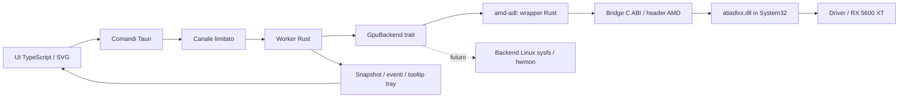

# Architettura e scelte hardware

## Prima capability, poi comandi

La RX 5600 XT è una GPU Navi. Non deduciamo la versione Overdrive dal nome:
il bridge enumera gli adapter presenti, filtra AMD e legge `ADL2_Overdrive_Caps`.
Gli adapter logici sono deduplicati per indirizzo PCI bus/device/function;
il relativo ID viene salvato nel JSON, senza presumere che l'indice ADL sia 0.
Il cambio di slot PCI richiede una nuova selezione esplicita.

Per il controllo iniziale richiediamo `ADL_OD8_FAN_CURVE`, tutti i dieci range
temperatura/velocità e `ADL2_Overdrive8_Setting_Set`. Funzioni esportate non
significano necessariamente funzione supportata: ogni risultato è controllato.
Il backend rifiuta il controllo se capability, telemetria o limiti mancano.

## Confine Rust / ADL

Il bridge compila contro tre header AMD non modificati, fissati al commit
`84c881cb2136f04287eb3af12de00a9e2867aa9e`. Solo strutture C semplici attraversano
il confine; `Point` usa `repr(C)`. Non servono bindgen, libclang, un SDK installato
separatamente o un processo Node in produzione. La DLL è caricata con
`LOAD_LIBRARY_SEARCH_SYSTEM32`, evitando cwd/PATH e DLL vicine all'eseguibile.

Il wrapper Rust possiede l'handle, non lo condivide tra thread e offre metodi
fallibili. `Drop` tenta il ripristino solo se la sessione ha applicato una curva;
aprire e chiudere una sessione diagnostica non cambia le impostazioni correnti.
Gli array allocati dalle API X2 usano il callback malloc del bridge e sono liberati
con il corrispondente free. Le strutture OD8 sono dimensionate dagli header reali.

Sequenza:

1. Caricamento DLL e simboli obbligatori/opzionali.
2. `ADL2_Main_Control_Create`, enumerazione e capability.
3. `ADL2_Overdrive8_Init_SettingX2_Get` / `Current_SettingX2_Get`, oppure API fisse
   se le X2 non sono esportate. Il numero feature in ingresso è `OD8_COUNT`.
4. Telemetria shared memory PMLog, quando supportata; se restituisce flag vuoti
   o errore, fallback `ADL2_New_QueryPMLogData_Get` (deprecata ma ancora presente
   nel driver verificato). Edge e hotspot sono gradi Celsius, non milligradi.
5. Scrittura di tutti i cinque punti in una singola chiamata, con `requested=1`
   solo per temperatura/ventola e Zero RPM. Verifica dei range e rilettura esatta.
6. Ripristino con i flag `reset=1` limitati alle stesse impostazioni delle ventole.
7. Stop logging, distruzione device/context e scaricamento DLL.

## Curva nativa e worker

Su questa alpha **il driver esegue la curva**, mentre il worker campiona e verifica.
Il vantaggio rispetto al PWM fisso scritto ogni 2,5 secondi è che, se il processo
si arresta, la GPU conserva una curva dipendente dalla temperatura.
Non simuliamo una velocità istantanea scrivendo tutti i punti allo stesso valore.
Il sensore usato internamente dalla curva è deciso dal driver; la presenza di
una lettura hotspot non prova che l'asse della curva sia configurabile sullo stesso sensore.

Il worker attende un messaggio o la prossima scadenza monotona: niente runtime
Tokio dedicato al polling, busy wait o richieste ADL dal browser. Gli eventi UI
contengono snapshot; un frontend nascosto non genera polling hardware.
Una lettura fallita invalida subito i valori visibili; due fallimenti consecutivi
durante il controllo provocano un tentativo di ripristino. Un salto di oltre 15 s
fra campioni durante controllo attivo viene trattato come sospensione/stallo.
Ogni quattro campioni la curva viene riletta per rilevare altri tool o reset driver.

Le soglie protettive alpha sono edge ≥90 °C o hotspot ≥105 °C: passaggio ai
default del driver e messaggio persistente. Non viene effettuato uno stop di
emergenza dell'OS e queste soglie non sostituiscono le protezioni hardware.

Un mutex Windows nominato impedisce a due sessioni di questa utility di scrivere
contemporaneamente la stessa GPU. Non può coordinare tool di terze parti:
Afterburner/Radeon tuning devono restare inattivi. Il plugin single-instance
impedisce due GUI attive. I comandi entrano in una coda limitata e la UI mostra
lo stato in attesa; se ADL si blocca dentro il driver non è possibile cancellare
in sicurezza quella chiamata FFI: un watchdog esterno resta un miglioramento futuro.

## Ripristino: garanzie e limiti

| Evento | Comportamento |
| --- | --- |
| Chiusura finestra | Nasconde nella tray; controllo invariato |
| Automatico | Ripristina le sole impostazioni ventole del driver |
| Esci da tray | Ripristino se curva applicata; errore impedisce l'uscita ordinaria |
| Errore lettura / scrittura | Valori invalidati, tentativo di ripristino; nessuna ripresa manuale automatica |
| Panic Rust con unwinding | `Drop` tenta cleanup; non è una garanzia per abort/access violation |
| Kill / alimentazione persa | Nessun cleanup eseguibile; curva nativa residua, comportamento successivo del driver da verificare |
| Nuovo avvio | Monitoraggio; non asserisce che i default siano già attivi |

Il reset ADL ai default delle ventole è la cosa esposta dall'API; **non equivale
a una prova formale di controllo BIOS autonomo** su ogni versione del driver.
Non usiamo un reset globale che cancelli undervolt o altri parametri dell'utente.

Per aggiungere una modalità PWM host affidabile servirà prima un supervisore
indipendente: heartbeat monotono, timeout e handle al processo controllore, stessa
identità GPU, ripristino via nuova sessione ADL e nessun lock detenuto per tutta la
vita che blocchi il watchdog dopo uno stallo. Un watchdog utente non copre
kernel hang, driver non responsivo, stop simultaneo di entrambi i processi o perdita alimentazione.

## Linux e isteresi

`GpuBackend` non dipende da Tauri o Windows. Il backend Linux futuro deve
identificare `amdgpu` via `/sys/class/drm/card*/device`, correlare l'hwmon giusto,
scoprire etichette edge/junction e scrivere soltanto file verificati `pwm1` /
`pwm1_enable`, rispettando permessi e range. Niente `sudo` nascosto nel frontend.
La modalità automatica e i valori di `pwm1_enable` vanno verificati sulla
documentazione del driver, non trattati come costanti universali.

Il core contiene interpolazione lineare, saturazione agli estremi e `StepDown`
testato: incremento immediato, decremento dopo permanenza continua sotto una banda
termica. Queste funzioni sono per futuri backend PWM diretti. La curva OD8 viene
trasferita al driver e **non espone un'isteresi software configurabile** in questa
alpha. L'UI lo dichiara, invece di mostrare una regolazione inefficace.

## Persistenza e frontend

`Config` valida schema/range e usa un file temporaneo nella stessa directory,
`sync_all` e sostituzione atomica. Un JSON corrotto resta al suo posto e produce
un errore; non attiva il controllo né viene sovrascritto automaticamente.
Nessun flag persistente manuale; avvio in monitoraggio per la validazione alpha.

Il frontend non ha API filesystem/shell, dipendenze remote, font CDN o accesso
diretto alla DLL. La CSP consente solo asset locali e IPC Tauri; autostart passa
per comandi Rust dedicati. I simboli grafici principali provengono dal logo SVG
originale; non viene caricato un intero font Material Icons per pochi controlli testuali.

## Fonti primarie

- [Sample AMD Overdrive8](https://gpuopen-librariesandsdks.github.io/adl/Overdrive8-example.html)
- [Header e sample AMD fissati a una revisione](https://github.com/GPUOpen-LibrariesAndSDKs/display-library/tree/84c881cb2136f04287eb3af12de00a9e2867aa9e)
- [Tauri v2: configurazione](https://v2.tauri.app/reference/config/)
- [Tauri v2: autostart](https://v2.tauri.app/plugin/autostart/)
- [Tauri v2: tray](https://v2.tauri.app/learn/system-tray/)
- [Tauri v2: installer Windows](https://v2.tauri.app/distribute/windows-installer/)
