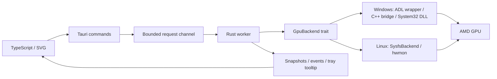

# Architecture and hardware control

## Capability discovery

The RX 5600 XT is the development target on both Windows and Linux.

### Windows (`amd-adl` / Overdrive8)

The Windows bridge enumerates present AMD adapters, reads `ADL2_Overdrive_Caps`, and deduplicates logical adapters by PCI bus/device/function (`pci:<bus>:<dev>:<fn>`). Control requires `ADL_OD8_FAN_CURVE`, all five temperature/speed ranges, `ADL2_Overdrive8_Setting_Set`, and valid temperature telemetry. Zero RPM also requires `ADL_OD8_FAN_ZERO_RPM_CONTROL` with a readable 0/1 range.

### Linux (`amdgpu` `sysfs`/`hwmon`)

`SysfsBackend` (in `crates/amd-adl/src/linux.rs`) discovers GPUs under `/sys/class/drm/card*/device`, accepting only numeric `cardN` entries (skipping connector subdirectories such as `card0-DP-1`). It verifies the `amdgpu` driver via the `device/driver` symlink or `uevent` (`DRIVER=amdgpu`), resolves a stable PCI address (`pci:<bus>:<dev>.<fn>`, stripping any `0000:` domain prefix), deduplicates by PCI ID, and locates `device/hwmon/hwmon*` (preferring `name == "amdgpu"`).

Moving a card to another PCI slot changes its saved ID and requires selecting it again.

`SysfsBackend::curve_info()` reports:
- `native_curve_supported = false` (no kernel Overdrive curve-table writes).
- `host_pwm_supported = true` when both `pwm1_enable` and `pwm1` exist.
- `writable = true` when both `pwm1_enable` and `pwm1` can be opened for writing.
- `zero_rpm_supported = true` when `host_pwm_supported` and `pwm1_min` is absent or `0`.
- `zero_rpm_enabled = true` when `pwm1_enable == 1` and `pwm1 == 0`.

Telemetry reads `temp1_input` (edge) and `temp2_input` (junction/hotspot) in millidegrees Celsius, `fan1_input` (RPM), and `pwm1` (`0..=255` scaled to 0–100%). Missing sensors remain `None`; `Sample::validate()` requires at least one temperature sensor in `1..=125` °C.

## Ownership and boundaries

One worker thread (`gpu-controller`) owns the `Box<dyn GpuBackend>` instance; `GpuBackend` handles are single-thread (`!Send`/`!Sync`). `Drop` attempts `restore_automatic()` only if this session wrote manual settings. Read-only probes (`list`, `probe`, or opening the GUI without enabling custom control) do not write hardware state or reset other controllers.

On Windows, the C++ bridge compiles against unmodified AMD headers pinned to revision `84c881cb2136f04287eb3af12de00a9e2867aa9e` and loads `atiadlxx.dll` with `LOAD_LIBRARY_SEARCH_SYSTEM32`.

On Linux, `SysfsBackend` accepts an injectable `sysfs` root (`SysfsBackend::with_root`) so automated tests exercise real filesystem I/O against temporary `sysfs`/`hwmon` directory trees without internal mocks.

## Curve execution and Zero RPM

`temperature_source` defaults to `gpu`, including profiles missing the field; alternatives are `hotspot` and `firmware`. GPU/hotspot modes interpolate the saved curve using exactly the selected sensor, on a one-second control clock (`polling_ms.min(1000)`) regardless of the monitoring interval. Missing selected readings are errors; unchanged `(speed, zero_rpm)` requests skip writes.

### Windows native OD8 vs Linux host-PWM (`StepDown`)

- **Windows (`native_curve_supported = true`)**: `speed_hold_points` positions five OD8 points as high as driver limits allow, holding the computed speed across the first four points with a final ramp to 100% at the driver's maximum curve-temperature limit (capped at 100 °C). **Driver / firmware sensor** (`TemperatureSource::Firmware`) sends the saved five points directly.
- **Linux (`native_curve_supported = false`, `host_pwm_supported = true`)**: **Driver / firmware sensor** is unavailable in the UI and rejected by both the worker and `fan-cli`. In `gpu` or `hotspot` mode, the worker passes the selected sensor reading through `fan_core::curve::StepDown` (`3.0` °C band, `6` s continuous delay): target temperature rises immediately on heating and steps down only after staying at least `3.0` °C below the held temperature for `6` continuous seconds, preventing audible fan hunting. The interpolated speed is mapped to `pwm1` (`0..=255` via `(percent * 255 + 50) / 100`) and written after setting `pwm1_enable=1`. Every write verifies readback of both `pwm1_enable` and `pwm1`; any mismatch triggers `restore_automatic()` (`pwm1_enable=2`).

### Zero RPM

Optional `zero_rpm_below_percent` defaults to disabled for older profiles. Core policy inverts the curve at the requested speed, rounding the temperature cutoff down. The first speed must be below the threshold (21–60%), and the cutoff cannot exceed 60 °C. Running curve values remain at least 20% (or the higher Windows driver minimum).

The selected sensor drives the gate (firmware mode on Windows uses the hotter available reading). Stop permission is requested below `cutoff - 3 °C`, retained below `cutoff`, and withdrawn at or above `cutoff`. Measured fan percentage is never the control input.

On Linux, requesting Zero RPM writes `pwm1=0` in manual mode (`pwm1_enable=1`) only if `pwm1_min` is absent or `0`. If `pwm1_min > 0`, Zero RPM is marked unsupported and rejected. Writing `pwm1=0` requests fan stop; VBIOS/firmware may still enforce a minimum fan speed or spin-up/down hysteresis. Actual fan stop must be confirmed via `fan1_input` RPM.

## Worker, coordination, and permission model

The worker sleeps until a request or monotonic deadline. Failed readings invalidate telemetry; two consecutive failures attempt restoration. Missing selected sensors in otherwise valid samples stop sensor control immediately. A gap over 15 seconds is treated as sleep/stall and triggers restoration. External modifications (e.g., `pwm1_enable` or `pwm1` changed outside the app) are detected on tick and trigger restoration rather than fighting another controller.

Edge ≥90 °C or hotspot ≥105 °C triggers restoration. These are application safeguards, not official AMD operating limits. A failed restore never reports automatic control as successful.

### Process coordination (`flock` / mutex)

- **Windows**: A named Windows mutex prevents two `amd-fan-control` / `fan-cli` sessions from writing the same GPU.
- **Linux**: `SysfsBackend` acquires a non-blocking exclusive `flock` (`LOCK_EX | LOCK_NB`) on `$XDG_RUNTIME_DIR/amd-fan-control/<sanitized_adapter_id>.lock` (falling back to `std::env::temp_dir()`; non-`/sys` test roots use a root-hashed subdirectory in `temp_dir()`). A second process attempting to write the same GPU fails immediately with a lock contention error instead of racing `pwm1`.

The `single-instance` Tauri plugin prevents duplicate GUI windows.

### Linux permission model (`udev`)

Reading `hwmon` temperatures, RPM, and `pwm1` works as an unprivileged user without extra setup. When `pwm1` or `pwm1_enable` is not writable (`writable == false` or `EACCES`/`EPERM`), the GUI remains in read-only monitoring mode and surfaces actionable guidance referencing `60-amd-fan-control.rules`.

Packaged `.deb` and `.rpm` installers deploy [`packaging/linux/60-amd-fan-control.rules`](../packaging/linux/60-amd-fan-control.rules) (`/lib/udev/rules.d/` for `.deb`, `/usr/lib/udev/rules.d/` for `.rpm`) and run `udevadm control --reload-rules` + `udevadm trigger --subsystem-match=hwmon --action=change` via `postinst.sh` / `postrm.sh`. The rule grants `TAG+="uaccess"` and `chgrp video` + `0664` strictly to `pwm1` and `pwm1_enable` on `amdgpu` `hwmon` devices (PCI vendor `0x1002`), leaving clocks, voltages, and power limits untouched.

| Event | Behavior |
| --- | --- |
| Close window | Hide to tray; worker continues |
| Switch custom control off / Use driver defaults | Persist the off choice and request automatic fan control (`pwm1_enable=2` on Linux); retain the saved custom curve |
| Quit from tray | Restore after custom control; preserve the saved startup choice; failure blocks ordinary exit |
| Read/write failure | Invalidate telemetry and attempt restoration |
| Rust unwind | `Drop` attempts cleanup; no guarantee after abort/access violation |
| Forced kill / power loss | No cleanup; manual curve / `pwm1_enable=1` may remain while control loop stops |
| Next launch | If explicitly enabled previously, attempt the saved curve once on the exact saved GPU after fresh telemetry; otherwise monitor only |

No independent watchdog or privileged `systemd` daemon exists.

## Configuration and frontend

Configuration lives at `%APPDATA%\amd-fan-control\config.json` on Windows and `$XDG_CONFIG_HOME/amd-fan-control/config.json` on Linux (via `dirs::config_dir()`). Same-directory temporary files, `sync_all`, and atomic replacement preserve the previous save on failure. Corrupt JSON is preserved and reported.

JSON backup uses the same schema and validation, neutralizing `custom_control_enabled` on export and capping imports at 1 MB. **Launch at login** delegates to `tauri-plugin-autostart` (Windows Registry Run key / Linux XDG `~/.config/autostart/` `.desktop` entry).

The English frontend uses local fonts, SVG, and system light/dark appearance. On host-PWM-only backends (`!native_curve_supported`), **Driver / firmware sensor** is disabled in the UI. On Linux, Tauri's tray relies on `libayatana-appindicator3-1` (GNOME Shell requires an AppIndicator extension).

## Updater and packaging pipeline

[`.github/workflows/build.yml`](../.github/workflows/build.yml) runs three jobs:
1. `core` (`ubuntu-latest`): `cargo fmt --check`, core/CLI/sysfs unit tests, and `glib-security-regression` (verifying the vendored `glib` iterator patch).
2. `windows` (`windows-latest`): frontend build, `tests/updater-manifest.test.mjs`, Playwright mocked-IPC UI tests, workspace tests, `clippy`, NSIS installer + portable ZIP + `SHA256SUMS.txt`, and build provenance attestation.
3. `linux` (`ubuntu-22.04` for broad `glibc` compatibility): frontend build, `tests/updater-manifest.test.mjs`, Playwright mocked-IPC UI tests, `cargo fmt --check`, workspace tests (including `SysfsBackend` temp-tree tests and `worker` host-PWM tests), `clippy`, `.deb`/`.rpm`/`.AppImage` bundles, `amd-fan-control-linux-x64-cli.tar.gz`, `SHA256SUMS.txt`, and build provenance attestation.

On `v*` tags, the `release` job combines Windows and Linux assets, generates a multi-platform `latest.json` (`windows-x86_64` pointing to the signed NSIS installer, `linux-x86_64` pointing to the signed `.AppImage`), validates it with `scripts/validate-updater-manifest.mjs`, and updates the rolling `updater` GitHub release.

Update checks are user-initiated. The `bundle_type` Tauri command inspects `tauri::utils::platform::bundle_type()`: on `.deb` and `.rpm` installs, the frontend skips `plugin-updater` and directs users to GitHub Releases; on Windows NSIS and Linux `.AppImage` installs, Rust verifies the minisign signature against the public key in `src-tauri/tauri.conf.json` before installing and calling `relaunch()`.

## References

- [Pinned AMD SDK](https://github.com/GPUOpen-LibrariesAndSDKs/display-library/tree/84c881cb2136f04287eb3af12de00a9e2867aa9e)
- [Overdrive8 example](https://gpuopen-librariesandsdks.github.io/adl/Overdrive8-example.html)
- [Linux kernel `amdgpu` thermal/fan `hwmon` docs](https://docs.kernel.org/gpu/amdgpu/thermal.html)
- [Tauri configuration](https://v2.tauri.app/reference/config/), [tray](https://v2.tauri.app/learn/system-tray/), [autostart](https://v2.tauri.app/plugin/autostart/), [updater](https://v2.tauri.app/plugin/updater/), [process](https://v2.tauri.app/plugin/process/)
