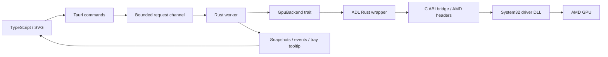

# Architecture and hardware control

## Capability discovery

The RX 5600 XT is the development target. The bridge enumerates present AMD adapters, reads `ADL2_Overdrive_Caps`, and deduplicates logical adapters by PCI bus/device/function. The saved ID is a PCI address, not a presumed ADL index. Moving a card to another slot requires selecting it again.

Control requires `ADL_OD8_FAN_CURVE`, all five temperature/speed ranges, `ADL2_Overdrive8_Setting_Set`, and valid temperature telemetry. Exported functions alone do not establish support. Zero RPM also requires `ADL_OD8_FAN_ZERO_RPM_CONTROL` with a readable 0/1 range.

## Ownership and boundaries

The bridge compiles against unmodified AMD headers pinned to revision `84c881cb2136f04287eb3af12de00a9e2867aa9e`. Fixed C-compatible structures cross the ABI; Rust `Point` uses `repr(C)`. No bindgen or separately installed SDK is required. `LOAD_LIBRARY_SEARCH_SYSTEM32` prevents searching the working directory, PATH, or app directory for the driver DLL.

One worker thread owns the ADL session; the handle is not `Send`/`Sync`. Drop attempts restoration only if this session wrote a curve. Read-only probes do not reset other controllers. X2 arrays use matching malloc/free. The bridge prefers X2 settings queries with fixed OD8 fallback. Telemetry prefers shared-memory PMLog, falling back to legacy PMLog when support flags are empty. Missing sensors remain absent.

## Curve execution and Zero RPM

The driver executes a native five-point curve. The worker never flattens all points into a periodic fixed-PWM command. Writes request only fan-curve entries and Zero RPM, then verify exact readback. Fan-only reset flags preserve unrelated tuning.

Optional `zero_rpm_below_percent` defaults to disabled for older profiles. Core policy inverts the curve at the requested speed, rounding the temperature cutoff down. The first speed must be below the threshold (21–60%), and the cutoff cannot exceed 60 °C. Running curve values remain at least 20% or the higher driver minimum.

The hotter available edge/hotspot sensor drives the gate. Stop permission is requested below cutoff minus 3 °C, retained below the cutoff, and withdrawn at or above it. A fresh sample determines the initial flag. Later transitions write only Zero RPM and verify readback, at polling intervals. Measured fan percentage is never the control input, preventing self-locking after fan stop.

Permission does not force physical 0% PWM or configure firmware restart hysteresis. The local RX 5600 XT exposes the toggle but no adjustable stop-temperature range. Actual stop/restart still needs hardware validation. The native curve may use a different internal sensor.

## Worker and recovery

The worker sleeps until a request or monotonic deadline. A hidden frontend does not issue hardware polling. Failed readings invalidate visible telemetry; two consecutive failures during custom control attempt restoration. A gap over 15 seconds is treated as resume/stall. Every four samples, curve values and the expected Zero RPM flag are checked for external changes; before a Zero RPM transition they are checked again. The app restores instead of fighting another controller.

Edge ≥90 °C or hotspot ≥105 °C triggers restoration. These are application safeguards, not official AMD operating limits. Failed Zero RPM writes/readback also trigger restoration. A failed restore never reports automatic control as successful.

A named Windows mutex prevents two utility sessions writing the same GPU. It cannot coordinate Afterburner or Radeon tuning. The single-instance plugin prevents duplicate GUIs. Requests use a bounded queue; stalled FFI calls cannot safely be cancelled.

| Event | Behavior |
| --- | --- |
| Close window | Hide to tray; worker continues |
| Restore automatic | Request fan-only driver defaults |
| Quit from tray | Restore after custom control; failure blocks ordinary exit |
| Read/write failure | Invalidate telemetry and attempt restoration |
| Rust unwind | Drop attempts cleanup; no guarantee after abort/access violation |
| Forced kill/power loss | No cleanup; curve and last Zero RPM flag may remain; gate stops updating |
| Next launch | Monitoring only; does not assert defaults are already active |

No independent watchdog exists. Fan-only reset is not a formal guarantee of autonomous BIOS control on every driver. Firmware retains its own stop/restart conditions if the worker terminates.

## Configuration and frontend

Configuration validates schema, curve invariants, interval, and Zero RPM policy. Same-directory temporary files, `sync_all`, and atomic replacement preserve the previous save on failure. Corrupt JSON is preserved and reported. No persisted manual-control flag exists.

The English frontend uses local fonts, SVG, and system light/dark appearance. Settings remain visible below or beside the curve. ResizeObserver keeps chart coordinates and hit areas in CSS pixels. Dragging captures the pointer on the stable SVG root, preserves grab offset, and suppresses text selection. Keyboard and numeric editing are alternatives. Draft changes are locked during custom control.

The frontend has no filesystem/shell access or remote dependencies. SVGs are emitted as local files (`assetsInlineLimit: 0`) because the desktop CSP disallows data URLs. Autostart reads OS state through dedicated commands.

## Future backends

The hardware trait is independent of Tauri/Windows. Linux sysfs/hwmon is not implemented. The core `StepDown` helper is for future host-PWM control, separate from native-curve execution and the Zero RPM gate. Host-PWM needs independent supervision and recovery semantics first.

## References

- [Pinned AMD SDK](https://github.com/GPUOpen-LibrariesAndSDKs/display-library/tree/84c881cb2136f04287eb3af12de00a9e2867aa9e)
- [Overdrive8 example](https://gpuopen-librariesandsdks.github.io/adl/Overdrive8-example.html)
- [Tauri configuration](https://v2.tauri.app/reference/config/), [tray](https://v2.tauri.app/learn/system-tray/), [autostart](https://v2.tauri.app/plugin/autostart/)
