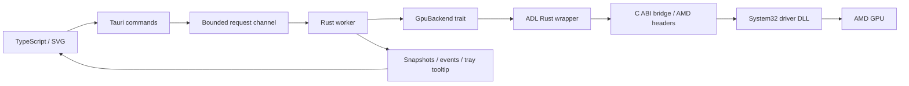

# Architecture and hardware control

## Capability discovery

The RX 5600 XT is the development target. The bridge enumerates present AMD adapters, reads `ADL2_Overdrive_Caps`, and deduplicates logical adapters by PCI bus/device/function. The saved ID is a PCI address, not a presumed ADL index. Moving a card to another slot requires selecting it again.

Control requires `ADL_OD8_FAN_CURVE`, all five temperature/speed ranges, `ADL2_Overdrive8_Setting_Set`, and valid temperature telemetry. Exported functions alone do not establish support. Zero RPM also requires `ADL_OD8_FAN_ZERO_RPM_CONTROL` with a readable 0/1 range.

## Ownership and boundaries

The bridge compiles against unmodified AMD headers pinned to revision `84c881cb2136f04287eb3af12de00a9e2867aa9e`. Fixed C-compatible structures cross the ABI; Rust `Point` uses `repr(C)`. No bindgen or separately installed SDK is required. `LOAD_LIBRARY_SEARCH_SYSTEM32` prevents searching the working directory, PATH, or app directory for the driver DLL.

One worker thread owns the ADL session; the handle is not `Send`/`Sync`. Drop attempts restoration only if this session wrote a curve. Read-only probes do not reset other controllers. X2 arrays use matching malloc/free. The bridge prefers X2 settings queries with fixed OD8 fallback. Telemetry prefers shared-memory PMLog, falling back to legacy PMLog when support flags are empty. Missing sensors remain absent.

## Curve execution and Zero RPM

`temperature_source` defaults to `gpu`, including profiles missing the field; alternatives are `hotspot` and `firmware`. GPU/hotspot modes interpolate the saved curve using exactly the selected sensor, on a one-second control clock regardless of the monitoring interval. Missing selected readings are errors; unchanged speed/Zero RPM requests skip writes.

`speed_hold_points` positions five OD8 points as high as their driver limits allow, with strictly increasing temperatures. The first four hold the computed speed; the last reaches 100% at the driver's upper curve-temperature limit, capped at 100 °C. Firmware can raise speed in the final ramp, preserving native escalation if the worker terminates. Unsupported ranges fail explicitly. No mapping between the firmware sensor and edge/hotspot is assumed, and no legacy direct-PWM API is used.

Firmware mode sends the saved five points directly, retaining the previous driver-selected sensor behavior. All writes request only fan-curve entries and Zero RPM and verify exact readback. Fan-only reset flags preserve unrelated tuning. The chart displays the user's requested curve, not the internal speed-hold points.

Optional `zero_rpm_below_percent` defaults to disabled for older profiles. Core policy inverts the curve at the requested speed, rounding the temperature cutoff down. The first speed must be below the threshold (21–60%), and the cutoff cannot exceed 60 °C. Running curve values remain at least 20% or the higher driver minimum.

The selected sensor drives the gate; firmware mode uses the hotter available reading. Stop permission is requested below cutoff minus 3 °C, retained below the cutoff, and withdrawn at or above it. A fresh sample determines the initial flag. Sensor mode combines speed/flag transitions; firmware mode writes only the flag. Both verify readback. Measured fan percentage is never the control input.

Permission does not force physical 0% PWM or configure firmware restart hysteresis. The local RX 5600 XT exposes the toggle but no adjustable stop-temperature range. Actual stop/restart still needs hardware validation. The native curve may use a different internal sensor.

## Worker and recovery

The worker sleeps until a request or monotonic deadline. A hidden frontend does not issue hardware polling. Failed readings invalidate telemetry; two consecutive failures attempt restoration. Missing selected sensors in otherwise valid samples stop sensor control immediately. A gap over 15 seconds is treated as resume/stall. Sensor mode checks the last confirmed curve/flag every tick; firmware mode checks every four samples and before flag transitions. The app restores instead of fighting another controller.

Edge ≥90 °C or hotspot ≥105 °C triggers restoration. These are application safeguards, not official AMD operating limits. Failed Zero RPM writes/readback also trigger restoration. A failed restore never reports automatic control as successful.

A named Windows mutex prevents two utility sessions writing the same GPU. It cannot coordinate Afterburner or Radeon tuning. The single-instance plugin prevents duplicate GUIs. Requests use a bounded queue; stalled FFI calls cannot safely be cancelled.

| Event | Behavior |
| --- | --- |
| Close window | Hide to tray; worker continues |
| Switch custom control off / Use driver defaults | Persist the off choice and request fan-only driver defaults; retain the saved custom curve |
| Quit from tray | Restore after custom control; preserve the saved startup choice; failure blocks ordinary exit |
| Read/write failure | Invalidate telemetry and attempt restoration |
| Rust unwind | Drop attempts cleanup; no guarantee after abort/access violation |
| Forced kill/power loss | No cleanup; curve and last Zero RPM flag may remain; gate stops updating |
| Next launch | If explicitly enabled previously, attempt the saved curve once on the exact saved GPU after fresh telemetry; otherwise monitor only |

No independent watchdog exists. Fan-only reset is not a formal guarantee of autonomous BIOS control on every driver. Firmware retains its own stop/restart conditions if the worker terminates.

## Configuration and frontend

Configuration validates schema, curve invariants, interval, Zero RPM policy and the GPU ID required for startup restoration. Same-directory temporary files, `sync_all`, and atomic replacement preserve the previous save on failure. Corrupt JSON is preserved and reported. `custom_control_enabled` stores the last explicit switch choice, defaulting to false for old profiles. The runtime `manual` flag remains separate and is true only after a write attempt, retaining its conservative true state if recovery fails.

Enabling custom control saves the choice and exact selected GPU only after driver readback succeeds; a failed save triggers restoration. Explicit off saves the preference and always attempts hardware restoration, including on a save error. Normal quit and safety stops do not erase the startup choice. At startup, telemetry errors defer the attempt; once a reading is available, the ordinary activation checks run again against a fresh sample. Missing selected sensors, excessive temperatures, changed GPU identity or driver rejection leave an error and prevent automatic retries in that session. A user command cancels a pending startup attempt. Settings drafts cannot overwrite the switch preference.

The English frontend uses local fonts, SVG, and system light/dark appearance. Settings remain visible below or beside the curve. Desktop layout sizes the chart within the viewport; narrow/short windows retain scrolling for reachable content. ResizeObserver keeps chart coordinates and hit areas in CSS pixels. Dragging captures the pointer on the stable SVG root, preserves grab offset, and suppresses text selection. Keyboard and numeric editing are alternatives. Draft changes are locked during custom control.

The custom-control switch follows the worker's confirmed manual state; command failures refresh the snapshot before unlocking controls. Switching off remains available without telemetry or curve capability. Recovery errors describe the operation, the confirmed restoration outcome, and the next action. Driver diagnostics appear under a separate **Technical details** disclosure. ADL -8 on a Zero RPM transition is explained as an unsupported operation; fan-stop write support is not inferred from readable capabilities.

The frontend has no filesystem/shell access or remote dependencies. SVGs are emitted as local files (`assetsInlineLimit: 0`) because the desktop CSP disallows data URLs. Autostart reads OS state through dedicated commands.

## Future backends

The hardware trait is independent of Tauri/Windows. Linux sysfs/hwmon is not implemented. `StepDown` remains available for future smoothing or a separate host-PWM backend. Current sensor control uses OD8 speed holds rather than direct PWM.

## References

- [Pinned AMD SDK](https://github.com/GPUOpen-LibrariesAndSDKs/display-library/tree/84c881cb2136f04287eb3af12de00a9e2867aa9e)
- [Overdrive8 example](https://gpuopen-librariesandsdks.github.io/adl/Overdrive8-example.html)
- [Tauri configuration](https://v2.tauri.app/reference/config/), [tray](https://v2.tauri.app/learn/system-tray/), [autostart](https://v2.tauri.app/plugin/autostart/)
